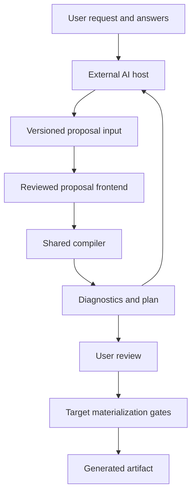

# AI-assisted automation authoring development proposal

Current continuation: the maintainer selected the broader
[system automation direction](SYSTEM_AUTOMATION_DIRECTION.md) on 2026-11-07.
It defines the next slices around complete environment lifecycles and supersedes
using application delivery or a pinned-file ledger as the primary product outcome.
The historical baseline and AI-A1–AI-A4 acceptance gates below remain intact.

Status: proposed implementation sequence. Baseline: `66a4ec77f18bd8fa04656783edc8ff7251d48b6d`, including merged PR #253. The maintainer requested this proposal after reviewing the concentration of recent work on adapter certification. Command names and new artifact fields below are proposed contracts.

## Product outcome

A user describes an automation goal, supplies known context and answers necessary questions. An external AI provider proposes an Intent document. Horistum checks the proposal through its shared compiler, returns actionable diagnostics, and makes the resulting plan available for review. The user selects a target when concrete output is needed. A revised proposal goes through the same complete checks.

Success means preserving the user's requested behavior, exposing unresolved decisions and producing a reviewable result within the actual capabilities of the selected target. Further adapter work should follow a reproducible obstacle encountered in this authoring path.

## Findings in the current implementation

| Existing component | Observed behavior | Consequence for development |
| --- | --- | --- |
| [Product CLI](../src/main/kotlin/org/flowlang/cli/honest/HonestFlowCli.kt) | `normalize` constructs `ScenarioPackIntentNormalizer` directly | Add a product entry point for an externally produced proposal |
| [Scenario registry](../src/main/kotlin/org/flowlang/scenarios/ScenarioPacks.kt) | Selects a predefined pack using trigger scores | Evaluate unfamiliar compositions and explicit exclusions |
| [Deployment pack](../src/main/kotlin/org/flowlang/scenarios/DeliveryScenarioPacks.kt) | Constructs test, image-build, deployment and verification steps | Detect extra steps when the user requests deployment of an existing image |
| [Reviewed proposal frontend](../src/main/kotlin/org/flowlang/frontend/ai/ReviewedAiProposalFrontend.kt) | Snapshots provider identity, request and response and invokes the compiler | Reuse its provenance capture and compiler entry point |
| [Proposal review](../src/main/kotlin/org/flowlang/ai/normalization/IntentProposalReview.kt) | Derives validation from the proposed Intent document | Independently evaluate whether the proposal preserved the original request |
| [CLI outcomes](../src/main/kotlin/org/flowlang/cli/honest/CliExecution.kt) | Defines typed outcomes and process exit codes | Reuse these in a bounded machine-readable result |
| [GitHub workspace planner](../src/main/kotlin/org/flowlang/targets/builtin/GitHubActionsWorkspaceContinuityPlanner.kt) | Recognizes `git.checkout` and `docker.build` endpoint shapes | Expand contracts when a real authoring case demonstrates an additional need |
| [Recovery roadmap](../.flow-agent/roadmap-architecture-recovery.yaml) | Places AR-07 after AR-06 and combines AI work with recovery cleanup | Select a bounded AI authoring slice separately from whole-milestone closure |

Compiler acceptance establishes validity of the represented Intent. Matching that Intent to the user's natural-language request requires additional evidence. A provider's confidence score cannot establish that match. The existing confidence fields currently contain heuristic or provider-declared values.

## Architecture and ownership



The AI host owns model access, prompt construction, conversation context and bounded repair attempts. The frontend owns strict input decoding and source capture. `FlowCompilationService` owns proposal review, semantic validation and graph authorization. Existing target materialization gates own rendering eligibility. External runtime systems own execution.

Each correction supplies a complete proposal snapshot and crosses the full compiler boundary. An earlier successful compilation grants authority only for its captured input. Target limitations are reported to the user as a decision to make. Any alternative plan requires explicit review of the resulting behavior change.

The user approves operational behavior, target selection and any proposed relaxation of constraints. Routine compilation and diagnostic inspection remain automatic.

## Proposed roadmap selection

Recommend selecting AI-A1 as the next implementation slice under the AI boundary responsibilities of AR-07. Its prerequisites are the existing shared compiler, reviewed proposal frontend and bounded product CLI delivered through AR-01 and AR-05, plus a passing baseline on current main.

The AI-A1 implementation PR should update the authoritative roadmap selector, release-state route and associated lifecycle checks together. Keep AR-06 open with its remaining evidence gaps. Record F-16 and F-20 against their existing closure owners. AR-07's complete recovery closure still requires its full exit criteria. AI-A1 must not be counted as closure of either milestone.

This proposal is linked from the roadmap entry page for review. Implementation activation belongs to the first implementation PR. The scope of that activation is AI-A1 alone.

| Slice | Deliverable | Acceptance gate | Dependency |
| --- | --- | --- | --- |
| AI-A1 | External proposal import and machine-readable compiler feedback | Installed CLI accepts valid proposals and explains rejected proposals through the existing compiler | Existing compiler and CLI baseline |
| AI-A2 | Request-fidelity corpus and review of requirements | Independently authored expectations expose missing requirements, invented work and changed constraints | AI-A1 |
| AI-A3 | One real-model integration and bounded repair demonstration | Reproducible captured attempts, explicit clarification and final reviewable plan across the held-out corpus | AI-A1 and AI-A2 |
| AI-A4 | Product-driven adapter extension | A blocked authoring case motivates a reusable contract and an independent second composition validates it | Evidence from AI-A2 or AI-A3 |

These slices are review boundaries, each normally one focused PR. Split a slice when it requires a new semantic contract, changes multiple compatibility boundaries or combines host integration with compiler behavior. A new semantic blocker receives its own work package before dependent implementation continues.

## AI-A1: external proposal import

Proposed invocation:

```sh
flow proposal request.json --out review
flow proposal request.json --target github-actions --render --out review
```

The first command compiles the supplied proposal and returns a plan or diagnostics. The second also requests materialization against an explicit target. The same input may be submitted by a person, CI or an external agent.

### Input contract

Introduce one versioned JSON envelope with a schema published alongside the command. Reuse `AiIntentRequest`, `AiIntentResponse` and `IntentDocument` for their existing meaning.

| Envelope field | Requirement |
| --- | --- |
| `formatVersion` | Explicit supported version, initially 1 |
| `providerId` | Nonempty provider identity, recorded as caller-declared provenance |
| `request` | Exact typed `AiIntentRequest`, including original text and supplied context |
| `response` | Complete typed `AiIntentResponse`, including normalized Intent and provider report |

CLI source identity comes from the actual input location. Local filesystem paths are derived by the reader rather than accepted as authority from JSON. Any target supplied both in the request and on the command line must agree. Target omission permits planning. Rendering requires explicit target selection.

Keep the full existing response shape in version 1, including its required report fields. Document every required field in a complete loadable example. Label confidence as provider-declared and advisory. A later change to optional reports or heuristic-score terminology needs an explicit compatible schema migration. AI-A1 should avoid forcing that migration into the import change.

Use bounded I/O and strict decoding. Reject duplicate keys, unknown versions, unknown fields, malformed Intent values, unsupported enum values and oversized/deeply nested input. Resolve module contracts through the existing explicit contract source. Preserve supported historical Intent inputs under their existing compatibility rules. Never silently upgrade or drop fields.

Proposal provenance identifies supplied bytes and their interpreted content. It does not attest that a named model actually produced them. The AI host records provider/model/version, prompt template version and actual request/response digests when it executes a real-model call in AI-A3.

### Result contract

Write a versioned `proposal-review.json` through the existing atomic CLI publication mechanism. Use the existing presentation and typed outcome mechanisms to expose the same information to interactive callers. Include source identity/digest, compilation stage, existing diagnostic codes and field locations where available, unresolved decisions, emitted artifact names and graph digest when a graph exists.

Separate the following conclusions in the result:

- Semantic acceptance of the proposed Intent.
- Outstanding provider-reported questions and risks that need review.
- Request-fidelity review state, initially `unassessed` for ordinary external text.
- Selected target and its actual materialization disposition when requested.

Provider-reported required questions withhold rendering until a subsequent proposal supplies the decisions. Empty provider questions cannot override compiler-derived diagnostics. Accepted semantics with unresolved request fidelity remain visible for human review. AI-A2 defines the stronger fidelity checks; AI-A1 must not manufacture a `verified` fidelity result.

Retain existing process codes: 0 for successful completion, 2 for invalid input, 3 for required review, 4 for a blocking result and 70 for an internal error. The implementation must align each new path with `CliExecutionResult` and preserve useful diagnostic evidence on rejection. Error messages must expose the failed stage and supported field paths without dumping raw request contents or credentials.

Output directories must obey the existing publication policy. A failed replacement must not mix files from different proposal revisions. Missing model metadata remains explicitly unknown. Prompts, repository files and credentials are sent to a model only by the separately configured AI host.

### Concrete first-PR checklist

1. Add the strict envelope reader and published schema within the frontend/product ownership boundary.
2. Register the `proposal` command in the product CLI, argument parser, help and installed distribution.
3. Route it through `ReviewedAiProposalFrontend` and `FlowCompilationService`.
4. Reuse compilation diagnostics, typed CLI outcomes and target materialization entry points.
5. Publish the bounded result and a complete input example.
6. Update the roadmap selection and work package for this bounded activation.
7. Verify the installed CLI, compiler convergence and rejection paths.

Inspect the existing frontend convergence tests, `ProductCliBoundaryTests`, `CliArgumentParserTests`, `AtomicCliPublicationTests` and input-limit tests before adding regressions. Required evidence includes identical canonical meaning for equivalent direct Intent and imported proposals, distinct provenance after provider/request changes, malformed input rejection before compilation, retained diagnostics on semantic rejection, missing-target rejection for rendering, explicit target conflict, required-question handling and atomic publication failure behavior.

AI-A1 must include one accepted example drawn from a currently representable Intent and one rejected example exercised through the installed CLI. The existing-image deployment request is also exercised and retains any diagnosed representability blocker. A fixture produced for this PR demonstrates the integration boundary. Real model quality is measured in AI-A3.

## AI-A2: preserve the user's request

Begin with the following acceptance case:

> The image is already in the registry. After approval, deploy this exact digest to production. If the health check fails, notify the team. Do not build another image and do not roll back.

A reviewer authors expectations independently of the candidate model. Bind approval ordering to the deployment operation, pin the image digest, constrain notification to the failure path and forbid added build/rollback effects. Evaluate these against represented graph behavior and authored values. If the current Intent or graph cannot express a requirement, preserve the request and report the representability blocker before adding any target-specific workaround.

For live user work, the AI host presents its extracted requirements with source references for user confirmation. This confirmation becomes input to request-fidelity review. A model-generated requirement list remains provisional until confirmed. Compiler safety obligations apply independently of this review.

Build an initial corpus of 12 requests with three domains and four cases per domain. Cover deployment of existing artifacts, backup/restore and certificate maintenance. Each domain includes a fully specified case, an ambiguous case, a case with explicit prohibitions and a case with an unsupported requirement. At least half the cases must differ structurally from existing scenario-pack examples. Establish reviewer-owned expected invariants before running candidate models and reserve half the cases as held out.

Test controlled proposal mutations that change a digest, add a forbidden build, move approval after the effect, remove a requested step or broaden an environment. Check preservation using existing canonical and capability/effect contracts. Add typed fidelity checks only for requirements whose semantics can be represented and evaluated. Keep uncheckable requirements visible for human review.

## AI-A3: real-model authoring and repair

Start with one explicitly configured provider hosted outside the compiler. Reuse an existing host integration if it can submit the proposal envelope and read the result. Select the provider when live evaluation begins, based on supported structured output, access and operating budget.

The host captures the initial proposal and every complete replacement. Suggested defaults are one initial model call and at most two automatic corrections, plus explicit per-run token and cost budgets. Clarification resumes only after the user's answer. Stop on exhausted budget, repeated unchanged proposals, absent user decisions or a representability blocker. Transient transport retries must stay within the same budget and preserve attempt identity.

Record model/provider version, prompt version, schema version, compiler commit, input digests, stage outcomes, clarification count, repair count, latency and provider-reported usage. API credentials remain outside captured fixtures. Redacted fixtures must be identified as redacted records, with digests calculated over the retained content. External deployment remains a separate user-authorized action.

Run the corpus at least three times with fixed recorded settings. Report first-pass acceptance, acceptance after correction, fidelity violations, unsupported cases, clarification quality, latency and cost separately. Any accepted hard-constraint violation in the corpus blocks the milestone. Treat unsupported cases as correctly classified only when the result identifies the missing capability and preserves the request. Completion also requires at least one faithful accepted canonical plan in each domain and a rendered artifact for one fully specified held-out case on an explicitly selected supported target. If a domain remains entirely blocked, record the concrete prerequisites and keep AI-A3 open. These bounded measurements do not establish general language-understanding accuracy.

## AI-A4: adapter development driven by actual authoring

For every requested adapter extension, record the original request, accepted Intent, compiler revision, concrete materialization blocker and expected preserved behavior. First determine whether the obstacle belongs to semantic representation, implementation binding or target projection.

For workspace transfer, investigate whether existing module and continuity contracts can identify producers and consumers through declared requirements. Before introducing a new abstraction, show why existing contracts cannot represent the case. Prove the implementation using at least two independently chosen compositions and a mutation that violates the relevant invariant. Measure completion by the newly supported request class and its boundaries.

## Decision and release gates

| Decision | Recommended choice | Tradeoff or prerequisite |
| --- | --- | --- |
| First investment | External proposal CLI with deterministic feedback | Establishes a usable boundary before measuring model quality |
| Model orchestration | External host using the versioned proposal/result contract | Host implementation and model access are needed for AI-A3 |
| Initial target use | One explicitly selected target per evaluation | General portability requires separate evidence for each target |
| Adapter sequencing | Select changes from reproducible blocked authoring cases | Some requested plans will first require semantic design |
| AI roadmap scheduling | Activate AI-A1 using completed compiler/CLI prerequisites | Requires coordinated selector and lifecycle updates in its implementation PR |

Each implementation PR uses a branch and PR against main. Validate focused regression cases, the installed CLI, module isolation, compiler/conformance checks and GitHub Actions for the final commit and merge candidate. Add native runtime checks when target behavior changes. Keep local deterministic fixtures separate from captured real-model evaluations in the published results.

After AI-A1, the first usable deliverable is a command that any external agent can call with a proposal and receive an actionable result. After AI-A3, the maintainer can demonstrate the full request, clarification, repair and review cycle on held-out requests. These are the proposed next product acceptance points.
