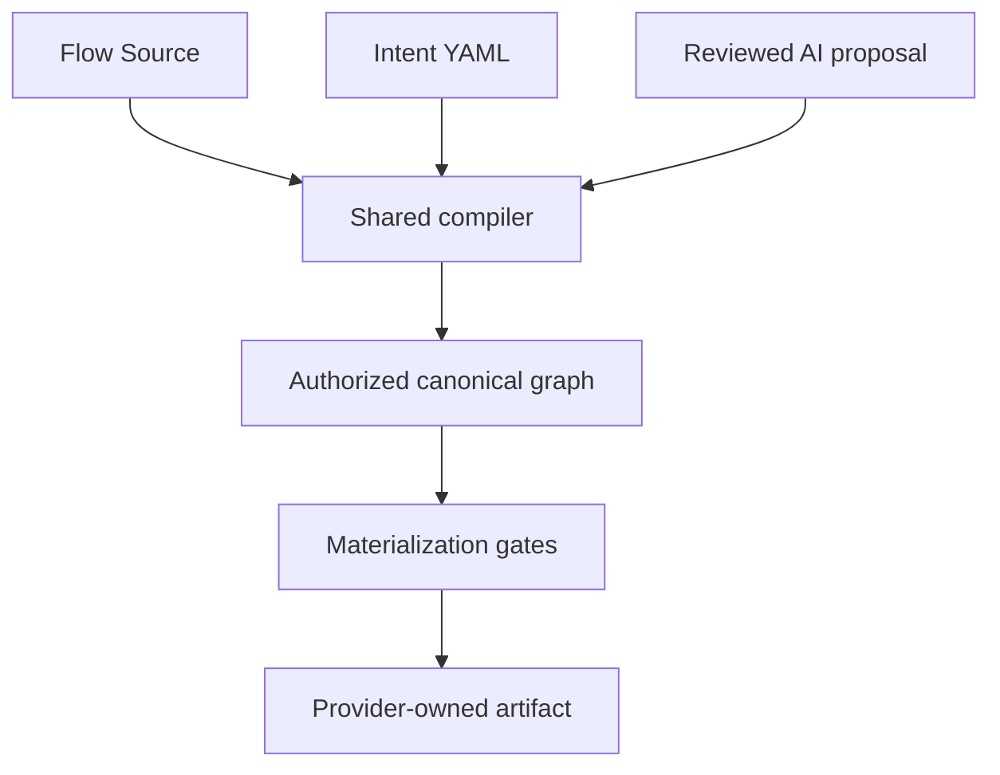

# Horistum architecture

Horistum separates automation intent, canonical meaning, implementation binding and target execution. Flow Core validates and plans; external runtime systems execute emitted artifacts. The [architecture constitution](../.flow-agent/architecture-constitution.md) defines the ownership rules. This page describes their implemented boundaries.

For development, follow the [active-roadmap route](../.flow-agent/README.md#active-roadmap-route). Completed milestone receipts and versioned documents describe their recorded revisions; they do not select current work.

## One compiler, three frontends



[FlowSourceFrontend](../src/main/kotlin/org/flowlang/frontend/source/FlowSourceFrontend.kt), [IntentYamlFrontend](../src/main/kotlin/org/flowlang/frontend/intent/IntentYamlFrontend.kt) and [ReviewedAiProposalFrontend](../src/main/kotlin/org/flowlang/frontend/ai/ReviewedAiProposalFrontend.kt) capture input and provenance, then call [FlowCompilationService](../src/main/kotlin/org/flowlang/compiler/FlowCompilationService.kt). Intent validation and lowering are implemented and precede the shared AST pipeline. Source parsing alone is not acceptance.

The compiler receives a decoded module catalog, environment policy and expression-parser interface. [FrontendCompilerComposition](../src/main/kotlin/org/flowlang/frontend/FrontendCompilerComposition.kt) supplies reference frontend components; the compiler does not discover YAML registries or concrete targets. It computes path-sensitive availability and supplies that result to validation and planning. Accepted output contains a typed canonical graph, digest, source evidence and authorization.

AI proposals retain provider identity, the authored request and the complete typed response. Deterministic review and Intent validation remain compiler-owned. Scenario normalization is heuristic; its confidence fields are not calibrated probabilities. Existing review/provenance boundaries do not close the AI cleanup assigned to AR-07.

## Meaning, construction and authorization

The semantic kernel owns canonical capability, control, effect, workflow and dependency meaning. Module contracts describe explicit actions, bindings, schemas and obligations; a module name or concrete platform does not define universal meaning.

The planner is a construction stage. `CanonicalExecutionGraph` owns represented execution meaning. `ExecutionPlan`, `CanonicalExecutionPlan` and `WorkflowExecutionPlanSet` are derived compatibility/public views. [CompilationAuthorization](../src/main/kotlin/org/flowlang/compiler/CompilationAuthorization.kt) validates the graph, recomputes its digest and checks that projected workflow plans still match.

Graph integrity protects meaning that reached the graph. It cannot recover an authored field omitted before graph construction; source-level admission and preservation tests are a separate obligation. Workflow identities, availability joins and failure regions are explicit. Multi-workflow compilation does not imply native multi-workflow materialization.

## Actual build boundaries

[settings.gradle.kts](../settings.gradle.kts) includes fourteen independently compiled Kotlin/JVM modules. The root aggregates verification and distributions and has no residual production implementation. These are actual Gradle names, not conceptual future names from older roadmap planning.

| Gradle module | Owned responsibility | Direct production project dependencies |
| --- | --- | --- |
| [flow-semantic-kernel](../flow-semantic-kernel/build.gradle.kts) | Typed canonical graph, digest and semantic contracts | None |
| [flow-module-contracts](../flow-module-contracts/build.gradle.kts) | Typed AST and decoded module-catalog contracts | semantic-kernel |
| [flow-compiler](../flow-compiler/build.gradle.kts) | Validation, availability, planning and canonical authorization | semantic-kernel, module-contracts |
| [flow-frontends](../flow-frontends/build.gradle.kts) | Parsing, source capture, strict readers, catalogs, normalization and JSON presentation | semantic-kernel, module-contracts, compiler |
| [flow-adapter-contracts](../flow-adapter-contracts/build.gradle.kts) | Explicit immutable adapter catalog | None |
| [flow-adapter-runtime](../flow-adapter-runtime/build.gradle.kts) | Compiler-side materialization, binding, continuity, control and topology gates | semantic-kernel, module-contracts, compiler, frontends, adapter-contracts |
| [flow-adapter-evidence](../flow-adapter-evidence/build.gradle.kts) | Generic provider evidence, certification and registry validation | adapter-runtime |
| [flow-adapter-jenkins](../flow-adapter-jenkins/build.gradle.kts) | Jenkins projection, expressions and native definitions | adapter-runtime |
| [flow-adapter-github-actions](../flow-adapter-github-actions/build.gradle.kts) | GitHub Actions projection, conditions and transport policies | adapter-runtime |
| [flow-adapter-tekton](../flow-adapter-tekton/build.gradle.kts) | Tekton projection and native definitions | adapter-runtime |
| [flow-standard-artifacts](../flow-standard-artifacts/build.gradle.kts) | Artifact contracts, public views, provenance and bundle integrity | semantic-kernel, adapter-runtime |
| [flow-reference-distribution](../flow-reference-distribution/build.gradle.kts) | Provider composition, packaged contracts and reference facades | adapter-runtime, adapter-evidence, standard-artifacts, adapter-jenkins, adapter-github-actions, adapter-tekton |
| [flow-cli](../flow-cli/build.gradle.kts) | Product commands, bounded input, diagnostics and publication | standard-artifacts, reference-distribution |
| [flow-conformance-kit](../flow-conformance-kit/build.gradle.kts) | Conformance, certification experiments, governance and verification commands | cli |

Dependency names in the last column omit `flow-`; this table lists project edges, not external libraries. The kernel excludes serialization and adapters. The compiler excludes frontend implementations, concrete adapters and verification code. `flow-adapter-runtime` is compiler-side infrastructure, not a workflow executor; its explicit frontend dependency supplies parsing and strict evidence readers.

Most files retain paths under `src/main/kotlin/org/flowlang`. Package directories do not identify compilation ownership. Sorted `gradle/*-sources.txt` manifests partition files; [source ownership enforcement](../gradle/production-source-ownership.gradle.kts) reconciles them with actual Gradle source sets. [Classpath gates](../gradle/production-module.gradle.kts) validate resolved compile and runtime dependencies. Product modules cannot depend on the conformance kit, and test fixtures cannot become production inputs. Physical source-deletion proofs exercise kernel, compiler, generic-adapter and installed-product isolation.

The [AR-03D module-boundary record](COMPILER_MODULE_BOUNDARIES.md) explains the extraction and retained APIs at that revision. Its historical counts and lifecycle statements do not describe the current release state.

## Materialization and target evidence

[ReferenceTargetProjections](../src/main/kotlin/org/flowlang/distribution/reference/ReferenceTargetProjections.kt) explicitly composes Jenkins, GitHub Actions and Tekton providers. Generic materialization consumes a supplied catalog; a target name or empty catalog cannot silently install reference providers.

The [target generation pipeline](../src/main/kotlin/org/flowlang/generators/manifest/TargetProjectionProvider.kt) checks authorization and the submitted plan, target selection, lowering, bindings, continuity, controls, topology and executable readiness before invoking a provider. The provider owns concrete syntax and artifact bytes. A diagnostic manifest is not permission to emit executable target syntax.

| Evidence or view | What it establishes |
| --- | --- |
| Registry declaration | A declared profile or capability, not implemented behavior |
| Provider mapping scope | The implementation's admitted shapes and limitations |
| Plan-specific readiness | Whether the selected provider can preserve this authorized plan |
| Authenticated runtime assessment | Observed behavior for an identity-bound, bounded scenario and its mutants |
| CI composition replay | Independently replayed source/graph/manifest/native observations for an admitted composition |

The `targets` command reports declarations, provider scopes and repository reference maturity. It does not authenticate native certification or authorize a plan. See [target maturity v2](migrations/target-maturity-report-v2.md) and [composition coverage](validation/composition-coverage.md) for the separate report contracts.

Jenkins control support is bounded by provider scopes, including finite literal loops, supported literal matches, fixed zero-delay retries and specified parallel behavior. GitHub Actions Boolean conditions and workspace transport have their own endpoint and context restrictions. Tekton has a provider without a certified native runtime portfolio. These facts do not establish general platform support or portable execution.

Signed assessments and CI composition observations are separate evidence classes. The GitHub workspace experiment is not yet independently admitted into composition coverage; conditional producers, repeated-control transport and general value/state continuity remain gaps. Green examples or scenario counts cannot close AR-06.

## Admission limits and migration ownership

The compiler explicitly rejects unsupported source meaning before graph authorization:

| Boundary | Current contract |
| --- | --- |
| Action-local result-handler rules | [Rejected until typed handler preservation exists](ACTION_RESULT_HANDLER_CONTAINMENT.md) |
| Data-operation payloads | [Unsupported transform filters/selections, aggregate fields and validation rules are rejected](DATA_OPERATION_PAYLOAD_CONTAINMENT.md) |
| Global variable declarations | [Rejected until initialization, ordering and lifetime semantics exist](GLOBAL_VARIABLE_INITIALIZER_CONTAINMENT.md) |
| Input values and approval parameters | [Explicit types, static defaults, option domains and message-only approval admission](INPUT_APPROVAL_VALUE_INTEGRITY.md) |
| Availability growth | [Deterministic budgets and neutral-join reduction; general state compaction remains open](AVAILABILITY_ANALYSIS_LIMITS.md) |

Admission boundaries do not implement rejected features. A-06 does not add approval timeouts, approver identity, quorum or dynamic defaults.

The [compatibility inventory](../.flow-agent/architecture/compiler-adapter-boundary-inventory.yaml) records retained facades, owners and exit criteria. New frontend flows use `CompilationUnit`; legacy raw-plan diagnostic/compatibility entries remain inventoried. Caller migration, behavioral parity and facade retirement belong to AR-07. Their presence alone is not evidence of an authorization bypass, and this update does not remove them or close F-20.

The [2026-10-20 audit](audits/2026-10-20-system-roadmap/README.md) remains a historical diagnosis. Follow the active recovery roadmap for subsequent containment and validation evidence.

## Distribution and verification

The product CLI composes providers and packaged, hash-checked contracts. Bounded input handling and [atomic artifact publication](migrations/atomic-artifact-publication.md) protect actual bytes; [packaged CLI contracts](migrations/packaged-cli-contracts.md) describe resource provenance and explicit overrides.

Product and verification executables have distinct classpaths. The root reference distribution's `flow-core` command includes verification commands; the standalone product distribution excludes the conformance kit. Neither owns native workflow execution.

Use the supported JDK 25 toolchain and existing checks:

```bash
python3 -m unittest discover -s tools/tests -p 'test_*.py'
python3 tools/flow_agent_validate.py
python3 tools/flow_agent_runner.py
./gradlew --no-daemon test installDist
./build/install/flow-core/bin/flow-core conformance
```

CI separately validates the exact PR head and synthetic merge candidate, including installed conformance and source-deletion isolation. Native runtime certification is a separate workflow. Final results must name the tested revision; historical passing runs and generated context are not current-head acceptance.
