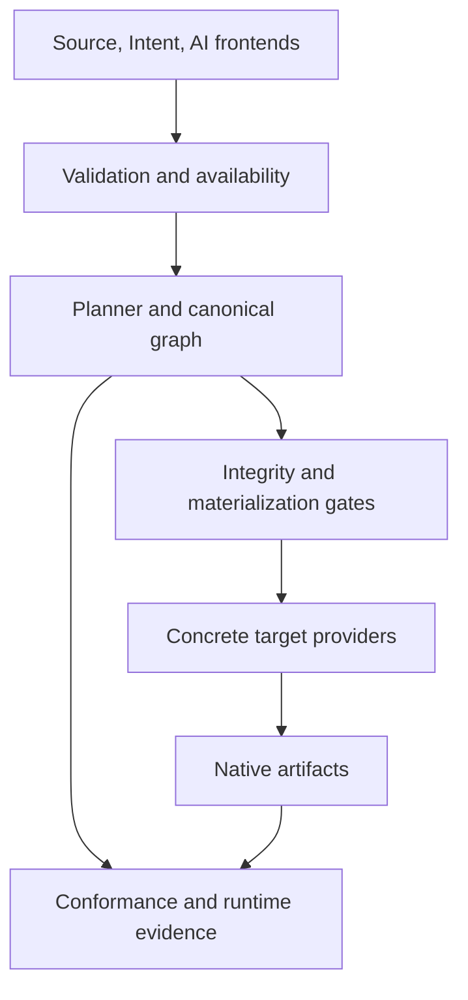

# System and roadmap audit — 2026-10-20

Audited main: `73b1c5054406175d96f7c6db5de4c39f80eb9313` (merge of PR #241).
Audited tree: `dc25349ee6928c81dd76d8b772c2df1a14d4034e`.

This audit inventories all production source owners, reviews each architectural layer and traces the critical source-to-artifact paths. It does not claim a line-by-line proof of every source file. Historical milestone acceptance, current implementation, independent observations and remaining product gaps are evaluated separately. The audit does not change release versions, accepted milestone receipts or target support declarations.

## Decision

Repair the source-to-plan preservation boundary before extending adapter support again. The real compiler accepted all 12 source-mutation pairs in this audit. Ten pairs with different authored fields collapsed to identical execution plans, canonical graphs and graph digests; both positive controls changed as expected. Most seriously, opposite action expectations and changed action handlers produced identical executable Jenkins and GitHub Actions artifacts under strict materialization.

The canonical graph, digest and target gates consistently agree with one another while failing to preserve fields that the planner omitted before graph construction. A graph-to-plan round trip cannot detect that class of defect. This is a correctness blocker for further capability expansion despite the green existing test suite.

AR-06 remains the active roadmap item; AR-07 remains planned and EF-09 paused. Their status is consistent across the current recovery authorities. Historical completion of AR-01 through AR-05 does not establish that every language construct is semantically preserved today. The findings below identify specific corrective work without rewriting historical evidence.

## Repository and architecture

At the audited revision, 1,994 tracked files include 436 main Kotlin source files (85,285 lines) and 288 files under the shared `src/test/kotlin` tree (39,733 lines). There are 332 Kotlin test-source files when module-local test roots are also counted. These are file counts, not executed tests. Production source manifests form a complete, disjoint partition across 14 Gradle modules; see [module-inventory.json](module-inventory.json).

| Module | Main files | Lines | Responsibility and review result |
| --- | ---: | ---: | --- |
| flow-semantic-kernel | 7 | 1,665 | Typed canonical graph and meaning; isolated from adapters and serialization implementations. |
| flow-module-contracts | 8 | 853 | Target-neutral action contracts and catalog interfaces. |
| flow-compiler | 56 | 12,892 | Validation, availability, planning and authorization; source preservation and analysis growth are the principal audit risks. |
| flow-frontends | 37 | 5,026 | Flow Source, Intent and AI proposals enter the common compiler; strict readers reject ambiguous authored input. |
| flow-adapter-contracts | 1 | 43 | Neutral adapter catalog boundary. |
| flow-adapter-runtime | 48 | 9,611 | Materialization negotiation, topology, continuity and shared adapter infrastructure. |
| flow-adapter-evidence | 35 | 7,345 | Runtime evidence authentication, admission and bounded support contracts. |
| flow-adapter-jenkins | 12 | 1,286 | Concrete Jenkins projection and explicit expression/control scopes. |
| flow-adapter-github-actions | 14 | 1,266 | Job projection, Boolean conditions and artifact/workspace transport. |
| flow-adapter-tekton | 6 | 413 | Concrete limited Tekton projection; no runtime certification in the current portfolio. |
| flow-standard-artifacts | 23 | 3,935 | Versioned standard artifacts, serialization and integrity support. |
| flow-reference-distribution | 8 | 517 | Composition of concrete providers and packaged contract resources. |
| flow-cli | 8 | 1,913 | Product command boundary, input handling and publication. |
| flow-conformance-kit | 173 | 38,520 | Verification implementation, independently excluded from the product classpath. |

The product contains 263 of those main-source files (46,765 lines). Verification accounts for the other 173 files. This is a maintenance-cost observation, not a quality score or a proposal to remove behavioral checks. The 318 `.flow-agent` files and 161 documentation files also make navigation and stale claims a real maintenance concern.

The roadmap's conceptual frontend/core module names differ from the actual consolidated Gradle modules. The relevant invariant is the enforced dependency direction, not matching every conceptual name literally.



### Controls that exist in production

- **One compiler entry point.** `FlowCompilationService` receives neutral module contracts. Frontends converge on validation, availability analysis, planning and canonical authorization. `ModuleCatalogIndex` snapshots identity and rejects ambiguous global type ownership.
- **Meaning and integrity.** `CompilationAuthorization.requireIntegrity` revalidates the graph, recomputes its digest and checks the derived plan/workflow projection. Digest framing is explicit; ordered semantic children remain ordered. This protects represented meaning, with the source-preservation limitation discussed below.
- **Availability and failure.** Branch joins distinguish definite and possible producers, explicit merges have identity, and workflow failure handlers are first-class regions. The legacy tail-try representation is checked against the typed failure region. Multi-workflow compilation exists; target materialization explicitly rejects unsupported multi-workflow execution.
- **Language and contracts.** Flow declarations track duplicate occurrences and source locations. Shared JSON/YAML policy rejects duplicates, trailing content, unsafe coercion and YAML aliases. Schema type/default checks and lossless semantic identity encoding are implemented, rather than inferred from documentation.
- **Materialization.** The pipeline validates the submitted plan and authorization, resolves capabilities, then applies continuity, control, topology and executable-readiness gates before a provider renders. Explicit endpoint scope remains separate from platform capability folklore.
- **Distribution and I/O.** Packaged contracts are resolved through indexed, hash-checked resources; external overrides are explicit. CLI arguments are typed and validated before publication. Inputs have byte/type/encoding limits. `AtomicArtifactWriter` stages actual bytes, checks them, then atomically publishes a directory; no non-atomic fallback is silently substituted.
- **Trust boundary.** Runtime certification authenticates challenge-bound evidence and runner signatures before admission, and binds graph and artifact bytes. Signatures prove origin under the configured trust root; they are not a proof that a trusted runner cannot lie. CI-bound composition replay remains a separate evidence class.

Primary code: [FlowCompilationService](../../../src/main/kotlin/org/flowlang/compiler/FlowCompilationService.kt), [CompilationAuthorization](../../../src/main/kotlin/org/flowlang/compiler/CompilationAuthorization.kt), [FlowPlanner](../../../src/main/kotlin/org/flowlang/planner/FlowPlanner.kt), [FlowAvailabilityAnalyzer](../../../src/main/kotlin/org/flowlang/core/FlowAvailabilityAnalyzer.kt), [AtomicArtifactWriter](../../../src/main/kotlin/org/flowlang/artifacts/AtomicArtifactWriter.kt), [ContractResourceResolver](../../../src/main/kotlin/org/flowlang/distribution/reference/ContractResourceResolver.kt).

## Findings and reproduction method

The opt-in [AuditProbe.kt](AuditProbe.kt) compiles pairs of actual `.flow` inputs through `FlowSourceFrontend`, then compares their source hashes, execution plans, canonical graphs and graph digests. For action handlers it also attempts strict Jenkins and GitHub Actions materialization and compares the actual rendered bytes. A direct `if true` versus `if false` pair is a positive control: semantic source changes must be detectable by the experiment.

The probe records observations. An exit code of zero means that observations were collected, **not** that semantic preservation passed. It does not turn present defects into golden expectations. The final recorded outputs and their limitations belong to this audited source revision; future repairs should change those outputs.

| Finding | Priority | Reproduced result |
| --- | --- | --- |
| A-01: action result handlers | High; first corrective PR | All three handler mutations disappear; both target providers emit identical executable bytes. |
| A-02: transform, aggregate, validate | High; canonical correctness | Four distinct payload changes disappear from the accepted plan and graph. Native execution is not claimed. |
| A-03: global variables | High; canonical correctness | Changing a referenced Boolean initializer does not change the accepted plan or graph. |
| A-04: availability growth | High; resource correctness | 4/8/12/14 shallow conditions produce 16/256/4,096/16,384 paths with no diagnostic. |
| A-05: documentation and migration | Low; existing cleanup ownership | Architecture entry-page drift and known AR-07 work; not an independently reproduced authorization bypass. |
| A-06: source input/parameter validation | Medium; fail-closed admission | Non-string option domains disappear; unknown approval parameter changes disappear; invalid source defaults can still be accepted. |

The minimal [true expectation](witnesses/action-expectation-left.flow) and [false expectation](witnesses/action-expectation-right.flow) produce the same [Jenkins artifact](witnesses/action-expectation-jenkins-right.txt) and [GitHub Actions artifact](witnesses/action-expectation-github-actions-right.txt). Their recorded artifact hashes are independently checked against generated bytes. These are generated executable artifacts, not a claim that this audit ran them on a new native runner.

### A-01 — action result-handler preservation

`ActionNode.handler` can contain `expect`, conditional `when` and `when error` rules. The parser, validator and availability analyzer process these fields. `FlowPlanner.planAction` constructs a task from parameters, effects, outputs and dependencies but does not transfer the handler or reject it. Graph construction starts from that task plan and cannot recover the missing rules.

The witnesses are `expect { true }` versus `expect { false }`, a checkout without a handler versus one with `when error { fail "must stop" }`, and conditional handler selection (`when true` versus `when false`). All are accepted with no validation issues. None of the distinctions survives into the plan, canonical graph or strict native artifacts. Merely including a different source hash in the compilation unit does not preserve operational behavior.

**Required repair:** make unsupported action result-handler semantics fail at the shared compiler boundary and the public direct-planner boundary, before executable authorization. Then implement a typed, target-neutral representation and explicit adapter preservation where intended. Add source-level mutation tests covering expectation truth, conditional handler selection, failure handling, handler-owned effects and downstream outputs. Do not fix this only by hashing the complete source: that changes identity while still dropping behavior.

### A-02 — data-operation payload preservation

The planner's transform branch keeps the source expression and target name but omits `where` and selected fields. Aggregate planning omits the aggregate fields; validate planning omits its rules. The AST contains those values, and validation reads them, so parser acceptance alone is not preservation.

The probe mutates each field independently. All four pairs are accepted without validation issues and produce equal plans, graphs and digests. This establishes information loss inside the compiler. It does **not** establish that a target currently executes these operations incorrectly: adapters commonly reject data operations. That downstream rejection is valuable containment, but a canonical semantic model must still preserve or explicitly reject the authored meaning.

**Required repair:** define the typed payloads and their effect/value semantics, or reject unsupported forms before issuing an accepted compilation. Cover all three frontends and graph serialization/digest behavior. Adapter support is a separate change after the core representation is correct.

### A-03 — referenced global variable definitions

Availability analysis admits `flow.vars` as initial bindings and validation checks their expressions. Planning retains input declarations but does not carry the global variable definitions. A `gate` variable initialized to `true` versus `false`, used by an otherwise identical condition, is accepted without issues and produces identical plans, graphs and digests.

Existing Jenkins and GitHub Actions expression scopes reject unsupported unbound roots, so this finding must not be described as demonstrated ambient-variable execution. It is a gap between accepted source meaning and the target-neutral plan.

**Required repair:** introduce explicit variable initialization/value semantics, or reject the unsupported binding use before compilation succeeds. A target-specific substitution would put source semantics in the wrong layer. Test shadowing, initialization order, cycles, workflow boundaries and references in task parameters as part of that bounded design.

### A-04 — exponential availability path expansion

`analyzeIf` evaluates both alternatives; `enterAlternative` expands every incoming path; `joinAlternatives` retains their union. Consecutive independent-looking conditions therefore multiply path identities. Repeating the same Boolean condition also fails to collapse the correlated alternatives. The current source-byte, token and nesting limits do not bound this semantic state growth.

The probe measured 4, 8, 12 and 14 shallow conditions using the actual analyzer. The 14-condition input is only 413 bytes and produces 16,384 paths with zero issues. In a separate JVM with a 256 MiB heap and 45-second process limit, a **557-byte, 20-condition input terminated with `OutOfMemoryError`** in availability path remapping after 40.728 seconds. See [stress-observation.json](stress-observation.json). Growth and the bounded failure are reproduced; exact timings and the failure threshold depend on the environment. This is compiler analysis, not workflow execution.

**Required repair:** first add a deterministic analysis budget with a diagnostic and no partial accepted result; then reduce equivalent states or use a compact symbolic representation while preserving branch-sensitive definite/maybe semantics. Test both the budget boundary and valid joins. Raising the JVM heap is not a repair.

### A-05 — documentation drift and remaining migration debt

`docs/ARCHITECTURE.md` is still headed as an early architecture version and describes module-owned meaning, an intent-draft role and broader target behavior that no longer match the constitution and current bounded providers. The root roadmap is a historical handoff, while active state is reached through post-toolchain and recovery roadmaps. Old decision-basis revisions are historical receipts, not proof that current code is absent.

AR-07 already owns AI confidence/provenance cleanup and compatibility facade retirement. The deterministic scenario normalizer still uses heuristics rather than a calibrated confidence model. The common AI frontend now has explicit provider/request/response provenance and deterministic review, so the old finding must not be repeated as if no boundary exists. Public legacy authorization entry points deserve migration review; this audit does not claim a demonstrated authorization bypass.

**Required repair:** after correctness containment, update the architecture entry page to the actual module boundaries and link one unambiguous active-roadmap route. Retire superseded facades only with caller migration and behavioral parity evidence. Do not create a second roadmap authority or a new runtime abstraction.

### A-06 — source input and approval parameter admission

`FlowValidator` validates module schema values, but its source-input default checks only warn about a string option default outside the declared domain. The probe accepts an unknown source input type and a Boolean input with a string default without any issue; an out-of-domain option default is accepted with a warning. `InputNode.toPlanInput` filters option values to strings, so `option [1, 2]` and `option [3, 4]` both become the same empty choices list without a diagnostic.

Approval validation checks expressions in arbitrary parameter values, while planning carries only `message`. `unexpected: 1` versus `unexpected: 2` is accepted without a warning and produces the same graph and executable Jenkins artifact. GitHub Actions correctly blocks this approval example on its topology requirement. The invented parameter is a negative admission witness, not a claim that Flow already promises a particular approver/timeout feature.

**Required repair:** close the source input type/default and approval parameter contracts. Resolve explicitly supported types and fields; reject invalid defaults and unsupported option members rather than dropping them. Unknown fields should not silently disappear. Keep this separate from implementation of new approval policy features and from the paused EF-09 domain assessment.

## Roadmap reconciliation

| Item | Recorded status | Current evidence and qualification | Audit decision |
| --- | --- | --- | --- |
| AR-00 | Completed | Unsupported structure is explicitly blocked; declared capability is not sufficient for execution. | Preserve historical acceptance; source-erased handlers require new containment. |
| AR-01 / F-04, F-09, F-17 | Completed | Common compiler, typed graph and derived-plan integrity are real. Source-to-plan coverage is not complete for the fields above. | Correct the preservation gap before expanding capabilities; do not equate graph round trips with full source preservation. |
| AR-02 / F-02, F-08, F-15 | Completed | Path-sensitive binding, workflow-set representation and typed failure policy exist. Native multi-workflow execution remains rejected. | Preserve bounded outcome; add resource bounds to availability analysis. |
| AR-03 / F-10 | Completed | Four independent isolation proofs match the current source. Production source manifests partition all 436 files; product excludes conformance. | Boundary outcome verified at current main. F-20 facade removal remains AR-07-owned. |
| AR-04 / F-07, F-12, F-13, F-14, F-21 | Completed | Strict readers, declaration uniqueness, module schema/default typing, system identity and lossless IDs are implemented. Source input admission still has A-06 gaps. | Preserve the specific implemented invariants; extend validation to the uncovered source input/parameter boundary. |
| AR-05 / F-03, F-05, F-19, F-22 | Completed | Packaged resources, typed CLI, byte integrity, atomic output and bounded input paths exist; product isolation verifies installed behavior. | Current evidence supports the bounded completion. |
| AR-06 / F-01, F-06, F-11, F-18 | Active | Runtime evidence and portfolio admission are substantial but explicitly bounded; composition coverage remains sparse. | Keep active. Correct source preservation before another support expansion. |
| AR-07 / F-16, F-20 | Planned | AI confidence remains heuristic; compatibility and governance cleanup remains. | Do not activate or close through this audit. |

Sixteen of the original 22 findings are assigned to completed milestones, four to active AR-06 and two to planned AR-07. This is ownership accounting, not a percentage of product completeness. New counterexamples must be tracked explicitly rather than hidden by historical status.

The post-toolchain external-falsification stream also needs precise interpretation:

- EF-02 through EF-08 completion means a domain was assessed. It does not mean every observed model gap was implemented. The seven completed domain baselines contain 46 recorded facts: 23 marked representable and 23 marked model gaps. These are historical classifications, not a fresh claim about every current feature.
- EF-09 human approval/change-control is paused after evidence admission. Its baseline contains nine facts (two representable, seven model gaps). It is not the next implementation item while recovery remains active.
- EF-10 synthesis is deferred; SI-2 depends on the resulting evidence. SB-01/SB-02, MT-01/MT-02 and AI-01 were absorbed into recovery ownership. MT-03 remains conditional, AI-02 planned, and V1 readiness unproven.
- Package version `0.9.5`, standard version `0.8.0`, contract schema versions and historical `0.9.7.x` roadmap items describe different axes. Their unequal numbers are not, by themselves, an inconsistency.

## Actual adapter coverage

Current-main runtime CI publishes an authenticated portfolio of 39 bounded assessments. These counts describe observed scenarios, not general target certification.

| Target | Provider | Signed scenarios | Construct rows with signed evidence |
| --- | --- | ---: | ---: |
| Jenkins | Yes | 36 | 12/12 |
| GitHub Actions | Yes | 3 | 2/12 |
| Tekton | Yes | 0 | 0/12 |
| Argo Workflows | No | 0 | 0/12 |
| Azure DevOps | No | 0 | 0/12 |
| Local | No | 0 | 0/12 |

Jenkins support is bounded by its provider scopes: finite literal loops, supported literal matches, fixed zero-delay retry and specific branch-local parallel behavior are not generic dynamic control support. GitHub Actions conditions use supported Boolean contexts, not arbitrary source expressions. Tekton materialization exists without a certified native runtime portfolio.

The independently replayed composition publication admits five producer archives into six of 72 target/construct rows: Jenkins conditions, parallelism, loops, match and retry, plus GitHub Actions conditions. The other 66 rows explicitly report no composition evidence. These rows are not a completion percentage and are not a claim that every missing combination should be implemented.

PR #241's workspace experiment separately proves unconditional checkout producers feeding selected top-level or nested-condition consumers. The replay binds the actual source, graph, manifest and native workflow envelope, checks selected/skipped jobs and restored regular-file bytes including hidden files, and rejects missing-transfer, hidden-file and guard-omission mutants. Conditional producers, consumers inside repeated control, general VALUE/STATE transport, native producer failure and filesystem metadata fidelity remain outside that bounded result. Independent workspace composition admission is still open; the passing experiment must not silently promote the portfolio.

## Evidence and verification

See [baseline-evidence.json](baseline-evidence.json) for exact run, artifact and hash metadata, and [observations.json](observations.json) for the source-mutation and bounded-analysis observations.

- [Flow CI 39426697791](https://github.com/Horistum/FlowAi/actions/runs/39426697791) completed successfully on the audited main. Its downloaded test reports contain **2,287 tests in 398 suites, zero failures, errors or skips**. The main-only merge-candidate job is intentionally skipped; this is not a missing PR validation result.
- The same run's standalone conformance JSON contains **274 checks, all passing**, inspected separately from JUnit results. No test count is inferred from source annotations or report titles.
- Four source-deletion isolation proofs match **783 input hashes** to the audited checkout: adapter 226, compiler 95, kernel 19 and product 443. Their 25 XML suites contain **170 tests, zero failures, errors or skips**. These are a separate isolation experiment, not additional unique product test cases.
- [Runtime CI 39426697906](https://github.com/Horistum/FlowAi/actions/runs/39426697906) completed successfully: 54 successful jobs and 10 intentional skips. Its portfolio job reauthenticated the complete declared runtime inventory; composition publication replayed the five admitted archives.
- Artifact ZIP SHA-256 values were checked against GitHub's API metadata. Publication manifests were checked against the bytes inside the downloaded archives. The workspace oracle was rerun locally against the downloaded current-main source/graph/manifest/envelope/observations. This is an independent replay of CI observations, not a new local native runtime execution or an independent re-signing of every portfolio assessment.
- The existing Python suite passed locally: **257 tests**. Flow Agent validation and context generation also passed. Local product compilation and the audit probe completed successfully using Gradle 9.5.0, Kotlin 2.4.10 and JDK 25.0.4.1+1: 12 source pairs, three input admission observations and four bounded path measurements. The initial cold full-test attempt was stopped in favor of targeted probe compilation after exact-main CI had supplied the full JVM baseline; it is not counted as a completed local JVM test run.

### Reproduce the audit observations

Use the repository's supported JDK 25 toolchain:

```bash
./gradlew --no-daemon --console=plain \
  -I docs/audits/2026-10-20-system-roadmap/probe.init.gradle \
  :flow-cli:runSystemAuditProbe
```

The task compiles product classes and the standalone diagnostic; it does not put audit code on a production source path. Generated source pairs, rendered artifacts and JSON observations are written under `build/system-audit/observations/`. Compare these with the recorded outputs only when the source revision matches. A corrected compiler should produce different observations.

The separate stress experiment deliberately limits both heap and wall time. After the task above, from the repository root:

```bash
python3 - <<'PY'
import os, pathlib, subprocess
root = pathlib.Path.cwd()
subprocess.run([
    str(pathlib.Path(os.environ['JAVA_HOME']) / 'bin/java'), '-Xmx256m',
    '-cp', (root / 'build/system-audit/classpath.txt').read_text(),
    'AuditProbeKt', str(root), str(root / 'build/system-audit/stress'), '20'
], timeout=45, check=False)
PY
```

On the audited revision the child exited with code 1 and a Java heap error. A slower machine may reach the timeout first. Neither outcome is a passing regression test; the evidence records the observed result.

## Implementation sequence after this audit

1. **Contain action-handler semantic loss.** One PR, one invariant: no accepted action result handler can disappear before authorization. Reject unsupported forms with an actionable diagnostic; preserve ordinary checkout behavior. Tests must mutate original source and inspect compilation rejection or actual preserved behavior, not just compare a plan with its own derived graph.
2. **Bound availability analysis.** Add deterministic resource accounting and fail-closed diagnostics, then optimize state representation with branch/merge regression coverage. Keep this independent from target support work.
3. **Complete or explicitly reject the remaining omitted source fields.** Separate the typed data-operation and global-variable design decisions into reviewable changes, and close the source input/approval parameter admission gaps. Inventory every AST field at the planner boundary and add behaviorally distinct source pairs. Do not introduce a generic raw-AST escape hatch in the canonical graph.
4. **Resume AR-06 on evidence, then AR-07.** Select the next bounded composition gap using the current matrix, with native falsification and explicit scope. Clean up compatibility and documentation under their existing ownership before recovery closure.

The audit is a reviewable diagnosis and reproduction package. It intentionally does not combine several compiler semantic changes, adapter expansion and roadmap closure into one PR.
